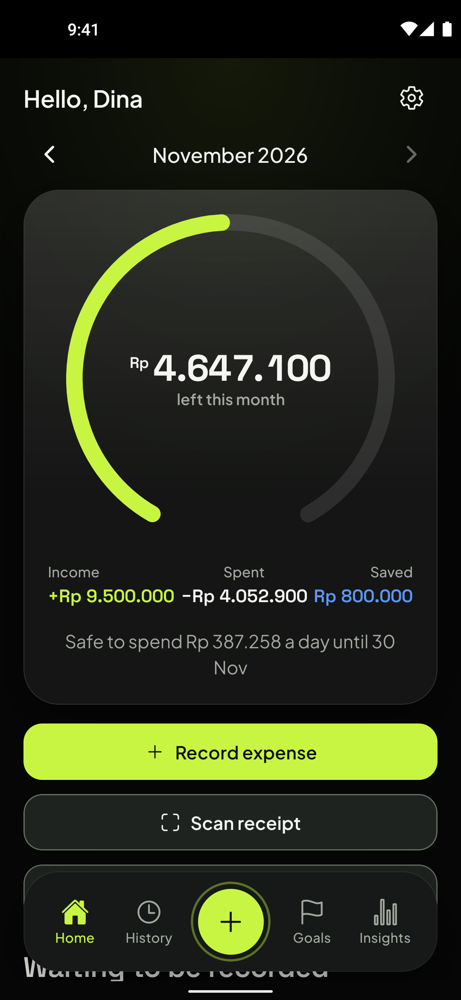
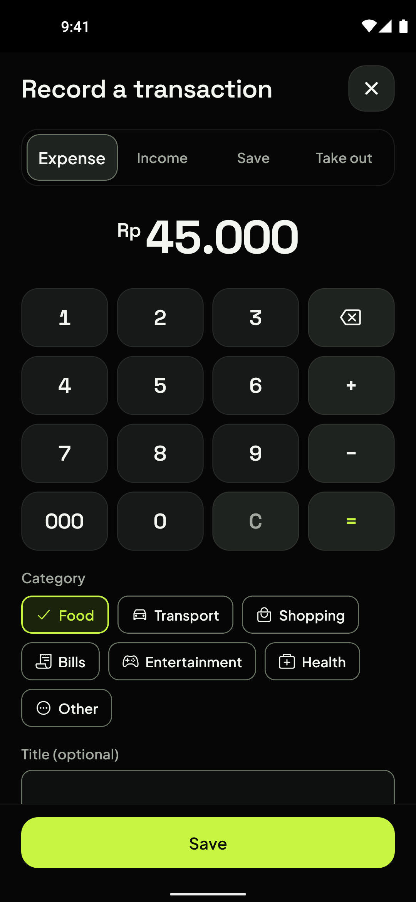
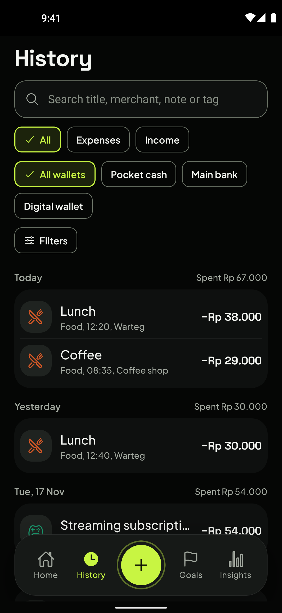
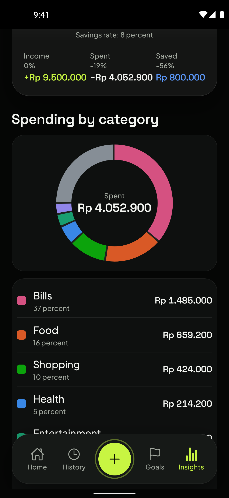
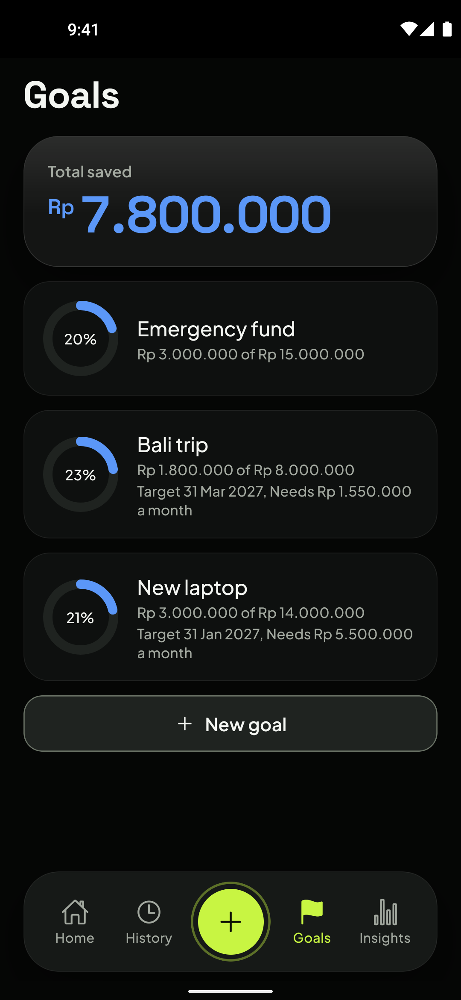

# VOIDSPEND

_track the drain._


VOIDSPEND shows where your salary goes each month. It needs no account, no bank connection and no server. Your records live in a database on your phone and nowhere else.

Open the app and the first thing you see is a ring. It starts full on payday and drains as you spend. Next to it is the number that matters: how much you can spend each day until the next payday.

**[Download the latest APK](https://github.com/itsvein13/voidspend/releases/latest)**

---

## Screenshots

<p align="center">
  
  
  
  
  
</p>

_Sample data. From left to right: Home, recording an expense, History, Insights and Goals._

---

## Why VOIDSPEND

Most expense trackers ask you to sign up, link a bank or send your spending to a server. VOIDSPEND does none of that. There is no login, no analytics and no network request of its own. If you delete the app, your data goes with it. If you want to keep it, one backup file holds everything.

It is built around one habit: write down what you spent, as it happens, in as few taps as possible. A calculator keypad, a category, and done.

## What you can do

**Know what is left**
- See what remains of this month's salary, and how much is safe to spend per day until payday.
- Watch income, spending and savings side by side, with the latest transactions underneath.

**Record fast, and record accurately**
- Add an expense or an income on a calculator keypad, with category, merchant, note and payment method.
- Every entry stores the real moment, the time zone and the local date. A coffee bought at 23:30 stays on its own day, even after you travel.
- Attach up to eight tags per entry and reuse them later. Rename or delete a tag in one place.
- Add a place by typing it, or let the phone read its position once with a tap. Location is never automatic and never read in the background.

**Scan receipts**
- Pick a photo of a receipt and the app reads it on the device. Nothing is uploaded.
- Check every field and every line, then save. Nothing is saved before you confirm.
- Duplicate receipts are flagged before they are saved twice.

**Plan ahead**
- Set savings goals with deposits, withdrawals, a target and progress.
- Set a budget per category and get a warning when a save crosses the limit.
- Add recurring items such as salary and bills. They are offered on the day they are due and recorded with one tap, with an optional reminder at 9:00.

**Understand your spending**
- Insights for a month or a year: income, spent, saved, savings rate and the change from the last period.
- A category donut that opens the matching transactions, month bars, top merchants and a calendar that shades each day by how much you spent.
- Search by title, merchant, note, place or tag, and filter by type, wallet, category, dates, amount, tag, receipt and place.

**Keep more than one wallet**
- Track cash, bank accounts and e-wallets, each with its own balance. A starting balance below zero works for a credit card or a loan.
- Move money between wallets without changing income, spending or savings.
- Narrow History and Insights to a single wallet.

**Stay in control of your data**
- Export a CSV, share a PDF summary, or back up everything as one JSON file and restore it on any phone.
- Deleted transactions stay for 30 days and can be restored.
- Lock the app with the phone's own fingerprint, PIN or pattern.
- Use it in Indonesian or English. It follows the phone and can be switched in settings.
- Choose dark, light or system theme. Reduced motion, large text and screen readers are supported, and on a wide window the bottom bar becomes a side rail and History shows the list and the details together.

## Install

1. On your Android phone, open the [latest release](https://github.com/itsvein13/voidspend/releases/latest) and download `voidspend-2.0.0.apk`.
2. Open the file. When Android asks, allow installs from your browser or file manager.
3. Open VOIDSPEND and follow the short setup: a nickname, your monthly salary and your payday. You can skip the salary and add it later from Home.

The app needs Android 7.0 or newer and a phone with a 64-bit ARM processor (arm64-v8a), which covers nearly all Android phones sold in recent years. It does not run on 32-bit phones or on x86 emulators.

If you used version 1, the first launch of version 2 imports your old data. It writes a backup file first and checks that the totals match before it finishes.

## Privacy

- Everything is stored in one SQLite database in the app's private storage.
- The app makes no network requests of its own and has no analytics.
- Receipt text is read on the device. Photos stay on the device.
- Location is read only when you ask for it, and is stored rounded to about 110 meters. It is left out of exports unless you tick it.
- Android can copy app data to your Google account with its own automatic backup. Check that setting on your phone if this matters to you.

## Known limits

- Android only. There is no iOS version.
- A receipt reader is only as good as the receipt. Faded thermal paper may need corrections, which is why review comes before saving.
- Receipt photos are not included in the backup file. The extracted fields are.
- Reminders are sent at 9:00 on the due date. The time cannot be changed yet.

Found a problem? Please [open an issue](https://github.com/itsvein13/voidspend/issues) and say what you did, what you expected and what happened.

## Support the developer

VOIDSPEND is free. If it helps you, you can support its development at [saweria.co/vein13](https://saweria.co/vein13). The same link is in the app under Settings.

## Build from source

```bash
git clone https://github.com/itsvein13/voidspend.git
cd voidspend
npm install
npx expo start --go
```

Open the QR code in Expo Go on an Android phone, or press `a` with an emulator running. Everything works in Expo Go except the on-device receipt reader, which needs a development build. Expo Go also warns that the notifications module is only partly supported there, and it cannot create the reminder channel, though reminders are still scheduled.

To build an installable APK with EAS:

```bash
eas build --platform android --profile apk
```

For a development build on a real phone, see `docs/v2-phone-test.md`.

Checks:

```bash
npm run typecheck
npm run lint
npm test
npx expo-doctor
```

## Tech stack

- [React Native](https://reactnative.dev/) 0.86 and [Expo](https://expo.dev/) SDK 57, React 19 with the React Compiler
- [Expo Router](https://docs.expo.dev/router/introduction/) for navigation
- `expo-sqlite` for storage, with SQL migrations and soft deletes. Money is stored in whole rupiah.
- Reanimated 4 and `react-native-svg` for motion and charts, with no chart library
- A small local Expo module around Google ML Kit text recognition (`modules/receipt-scan`)
- `expo-location`, `expo-image-picker`, `expo-document-picker`, `expo-local-authentication`, `expo-notifications` (local reminders only), `expo-print`, `expo-sharing`, `expo-haptics`
- Space Grotesk and Plus Jakarta Sans
- Jest with Testing Library. Repository tests run real SQL on Node's built-in SQLite.

## Design

The identity grows from the app icon: a V falling into a ring. Lime marks the main action and money that is left, blue marks savings, red appears only for problems, and amber means a limit is close. Spending is shown in neutral text with a minus sign, so red keeps its meaning. Notes on every milestone, with the decisions and the reasons for them, are in `docs/`.

## Author

Built by **Rizki**, [@veingh0st](https://instagram.com/veingh0st).

---

_VOIDSPEND is a personal project built to explore product design and mobile development end to end._
